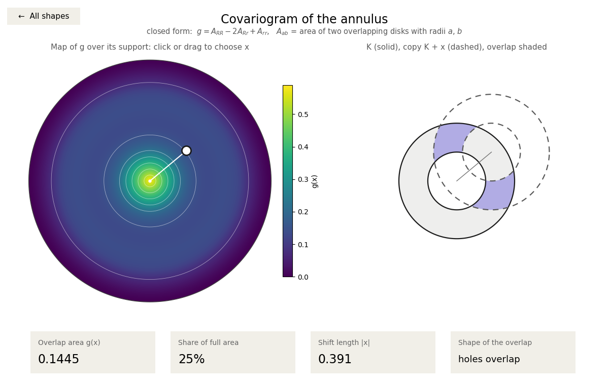
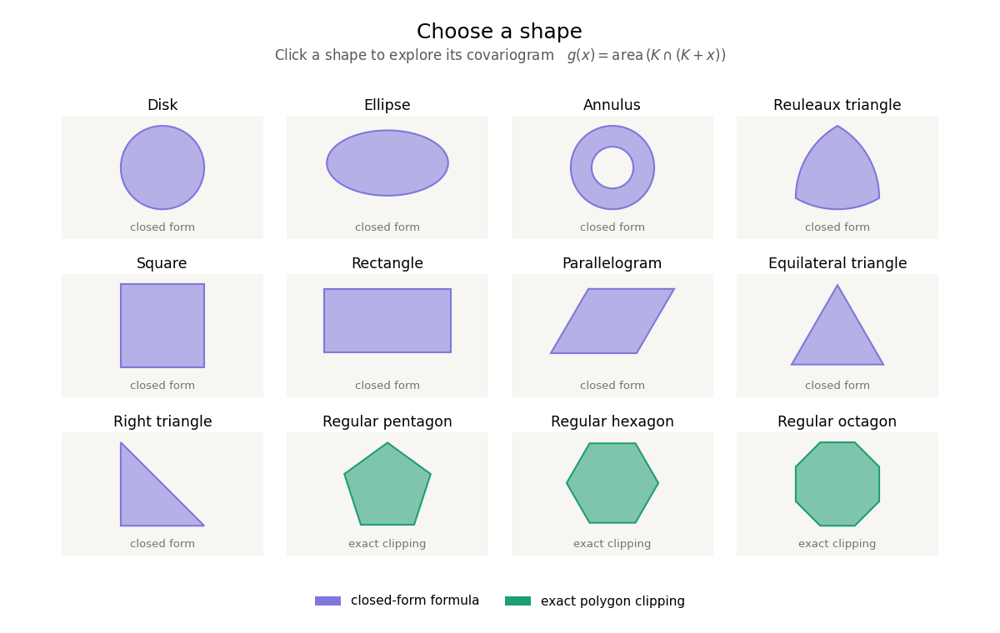
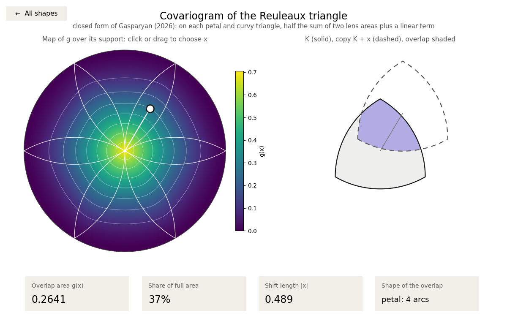

# CovariogramExplorer

[](https://github.com/manvelgasparyan/covariogram-explorer/actions/workflows/tests.yml)
[](LICENSE)


**Exact covariograms of planar shapes in Python, with an interactive explorer.**

Pick a shape, drag a shift $x$, and watch the shape $K$, its translate $K + x$ and their
overlap. The program shows the covariogram

$$g_K(x) = \lambda_2\bigl(K \cap (K + x)\bigr),$$

the area of the overlap, both as a colour map over all shifts and as an exact value.

<p align="center">
  
</p>

## Why

The covariogram is a basic object of geometric probability, stochastic geometry and
mathematical morphology. Divided by $\lambda_2(K)^2$, it is the probability density of the
difference $X - Y$ of two independent uniform random points of $K$. It therefore determines
the distribution of the distance $|X - Y|$, and for convex shapes the chord length
distribution in every direction.

Exact covariograms are known for only a few shapes, and the formulas are scattered across
the literature in different notations. covariogram-explorer collects them in one package,
checks each one against independent computations, derives distance and chord length
distributions from them, and lets you see what each formula describes.

## Features

- **A gallery of twelve shapes.** Click one to explore it.
- **An interactive explorer:**
  - a colour map of $g$ over its support $K - K$;
  - the shape, its translate and their overlap, all following the shift as you drag it;
  - the exact value of $g(x)$, its share of the full area, $|x|$, and a description of the
    overlap, such as "a lens (2 arcs)", "a smaller copy" or "petal: 4 arcs".
- **Exact values.** Nine shapes use closed-form formulas, and convex polygons are computed
  exactly by polygon clipping.
- **A Python library.** The covariograms are vectorised over NumPy arrays, and the package
  also provides:
  - uniform random points in every shape;
  - the distribution of the distance between two random points;
  - chord length distributions, both for a fixed direction and for isotropic random lines;
  - the covariogram of binary images, for testing estimators against the exact values.
- **Easy to extend.** Any convex polygon becomes a new shape in one line.
- **A Windows program.** A standalone `.exe` is available that needs no Python installation.
- **Tested.** Every formula is compared with brute-force clipping, basic identities and
  classical results.

<p align="center">
  
</p>

## Shapes

| Shape | Covariogram $g(x)$ | Method |
|---|---|---|
| Disk, radius $\rho$ | $\rho^2 L(\lvert x\rvert/\rho)$, where $L(d) = 2\arccos\frac{d}{2} - \frac{d}{2}\sqrt{4-d^2}$ is the area of a lens | closed form |
| Ellipse, semi-axes $a, b$ | $ab\,L\bigl(\sqrt{(x_1/a)^2 + (x_2/b)^2}\bigr)$ | closed form |
| Annulus, radii $R > r$ | $A_{RR} - 2A_{Rr} + A_{rr}$, where $A_{ab}$ is the area of two overlapping disks | closed form |
| Reuleaux triangle | half the sum of two lens areas plus a linear term on each of 12 pieces (Gasparyan, 2026) | closed form |
| Square, rectangle $a \times b$ | $(a - \lvert x_1\rvert)_+ (b - \lvert x_2\rvert)_+$ | closed form |
| Parallelogram $M[0,1]^2$ | $\lvert\det M\rvert\,(1 - \lvert y_1\rvert)_+ (1 - \lvert y_2\rvert)_+$, where $y = M^{-1}x$ | closed form |
| Any triangle $M T_0$ | $\frac{\lvert\det M\rvert}{2}\bigl(1 + \min(0, y_1 + y_2) - \max(0, y_1) - \max(0, y_2)\bigr)_+^2$, where $y = M^{-1}x$ | closed form |
| Regular pentagon, hexagon, octagon, and any convex polygon | area of the clipped polygon (piecewise quadratic in $x$) | exact clipping |

Here $T_0$ is the triangle with vertices $(0,0)$, $(1,0)$ and $(0,1)$. In the gallery, the
equilateral and the right triangle use this formula. The overlap of a triangle with any of
its translates is always a smaller copy of the triangle.

## Installation

### Windows: no Python needed

Download `CovariogramExplorer.exe` from the
[Releases](https://github.com/manvelgasparyan/covariogram-explorer/releases) page and double-click it.
The program is not code-signed, so Windows may show "Windows protected your PC" the first
time. Click **More info** and then **Run anyway**.

### With Python (Windows, macOS, Linux)

```bash
pip install git+https://github.com/manvelgasparyan/covariogram-explorer
covariogram-explorer
```

`python -m covariogram_explorer` also starts the program. The only dependencies are NumPy
and Matplotlib.

## Usage

The program opens with the gallery. Click a shape to open the explorer.

| Action | What it does |
|---|---|
| Click or drag on the map (left) | choose the shift $x$ |
| Drag in the right panel | slide the copy $K + x$ |
| Arrow keys | nudge $x$ (hold Shift for bigger steps) |
| `0` | reset $x$ to the origin |
| `B`, `Esc` or the "All shapes" button | back to the gallery |

Command-line options:

```bash
covariogram-explorer --list                         # list the shape names
covariogram-explorer --shape reuleaux-triangle      # open a shape directly
covariogram-explorer --shape annulus --x 0.3 0.25   # start at a given shift
covariogram-explorer --shape hexagon --save fig.pdf # save a picture instead of opening a window
covariogram-explorer --version
```

In Jupyter, run `%matplotlib widget` first (this needs `pip install ipympl`), then:

```python
from covariogram_explorer import App, make_shapes
App(make_shapes()).show_gallery()
```

<p align="center">
  
</p>

## Using it as a library

```python
import numpy as np
from covariogram_explorer import make_shapes

shapes = {s.slug: s for s in make_shapes()}
x = np.array([0.2, 0.1])
for slug in ["disk", "annulus", "reuleaux-triangle", "right-triangle", "hexagon"]:
    s = shapes[slug]
    print(f"{s.name:18s} g(x) = {s.value(x):.6f}  ({s.describe(x)})")

# vectorised: g along the ray at 30 degrees, in one call
r = np.linspace(0, 1, 6)
ray = r[:, None] * np.array([np.cos(np.pi / 6), np.sin(np.pi / 6)])
print(np.round(shapes["reuleaux-triangle"].covariogram(ray), 4))
```

```text
Disk               g(x) = 0.563669  (a lens (2 arcs))
Annulus            g(x) = 0.259363  (holes overlap)
Reuleaux triangle  g(x) = 0.484894  (curvy triangle: 3 arcs)
Right triangle     g(x) = 0.180000  (a smaller copy)
Regular hexagon    g(x) = 0.440540  (a hexagon)
[0.7048 0.5072 0.3236 0.1664 0.0502 0.    ]
```

Every shape has `covariogram(P)`, which is vectorised over arrays of shape `(..., 2)`. It
also has:

- `value(x)` and `describe(x)` for a single shift;
- `contains(P)` (an exact membership test) and `sample(n, rng)` (uniform random points);
- the geometric quantities `area`, `perimeter`, `width(u)` and `support_radius()`.

### Distances, chords and images

```python
import numpy as np
import covariogram_explorer as ce

R = ce.get_shape("reuleaux-triangle")
ce.mean_distance(R)                                  # E|X - Y| = 0.43591669...
ce.distance_cdf(R, [0.2, 0.4, 0.6, 0.8])             # P(|X - Y| <= s)
ce.chord_length_cdf(R, 0.5, direction=np.pi / 3)     # chords parallel to a side
ce.chord_length_cdf(R, 0.5)                          # isotropic random lines
image, x, y = ce.rasterize(R, 0.01)                  # binary image of the shape
lags_x, lags_y, C = ce.covariogram_from_image(image, 0.01)
```

| Function | What it computes |
|---|---|
| `isotropic_covariogram(K, r)` | the rotational average of $g$ |
| `distance_density(K, s)`, `distance_cdf(K, s)` | the distribution of $\lvert X - Y\rvert$ for independent uniform points of $K$ |
| `distance_moment(K, k)`, `mean_distance(K)` | $E\lvert X - Y\rvert^k$ and $E\lvert X - Y\rvert$ |
| `chord_length_cdf(K, r, direction=None)` | chord length distribution in a direction, or for isotropic random lines (convex $K$) |
| `mean_chord_length(K)` | $\pi\,\mathrm{area}/\mathrm{perimeter}$ (Cauchy–Crofton) |
| `rasterize(K, pixel)`, `covariogram_from_image(image, pixel)` | the covariogram of a binary image, computed exactly with the FFT |

## Adding your own shapes

Any convex polygon works out of the box. Its covariogram is computed exactly by clipping:

```python
import matplotlib.pyplot as plt
from covariogram_explorer import App, ConvexPolygon, Parallelogram, make_shapes

kite = ConvexPolygon([(0, -0.5), (0.35, 0), (0, 0.6), (-0.35, 0)], "Kite", "kite")
rhombus = Parallelogram((0.7, 0), (0.35, 0.35 * 3**0.5), "Rhombus", "rhombus", "a parallelogram")

App(make_shapes() + [kite, rhombus]).show_gallery()
plt.show()
```

For a shape with a closed-form covariogram, subclass `Shape` and implement:

- `rings()`, which returns the boundary as closed polylines, with the outer ring
  counterclockwise and holes clockwise;
- `covariogram(P)`, which returns $g$ for an array `P` of shape `(..., 2)`;
- `contains(P)`, an exact membership test. This one is recommended: the default uses the
  polygonal boundary.

Optionally, `describe(x)` describes the overlap and `overlay()` adds curves to the map.

## Examples

| Script | What it shows |
|---|---|
| `examples/library_usage.py` | evaluating covariograms (the output above) |
| `examples/distances.py` | mean distances, and the distance distribution checked against a simulation |
| `examples/chords.py` | chord length distributions of the Reuleaux triangle |
| `examples/images.py` | the covariogram of a digitised shape compared with the exact one |
| `examples/add_shapes.py` | adding a kite and a rhombus to the gallery |
| `replication/replication.py` | all results and figures of the accompanying paper |

`examples/distances.py` gives, for example, the mean distance between two random points of
the Reuleaux triangle of width 1: $E\lvert X-Y\rvert = 0.43591669$. For the disk, the
square, the rectangle and the equilateral triangle, the computed means agree with the
classical exact values to within $10^{-8}$.

## Tests

```bash
pip install -e ".[test]"
pytest
```

The tests make the following checks:

- Every shape is compared with brute-force clipping of independent high-resolution polygons.
  The curved shapes agree to about $10^{-8}$, the accuracy of the reference, and the polygons
  agree to rounding precision.
- $g(0)$ equals the area, $g(-x) = g(x)$, and $\int g = \lambda_2(K)^2$.
- The mean distances are compared with the classical exact values, and the distance
  distributions with simulations.
- The chord length distributions are compared with exact formulas, for the disk and for the
  Reuleaux triangle, and with the Cauchy–Crofton mean chord length.
- The image covariogram is compared with brute-force pixel counting.
- The window and the command line are driven with simulated events.

`python tests/test_covariogram_explorer.py` prints a summary table. The tests run on every
push via GitHub Actions on Linux, Windows and macOS.

## How it works

- **Closed forms.** The formulas are written with NumPy array operations, so a whole map of
  $g$ takes one call. For the Reuleaux triangle, each point is assigned to its petal or curvy
  triangle with boolean masks.
- **Polygons.** For a convex polygon, $K \cap (K + x)$ is again a convex polygon whose sides
  have the same directions as the sides of $K$. The program computes it with
  Sutherland–Hodgman clipping and takes its exact area with the shoelace formula.
- **Drawing.** The overlap is not computed for display. The program draws the translate
  clipped by the shape itself, so moving $x$ only changes one transformation. The same
  method handles shapes with holes, such as the annulus.

## Building the Windows executable yourself

On Windows, with Python 3:

```bash
pip install . pyinstaller
pyinstaller --onefile --windowed --name CovariogramExplorer --icon assets/icon.ico scripts/launch_explorer.py
```

The executable is written to `dist/CovariogramExplorer.exe`. When you push a version tag
such as `v1.1.0`, the workflow `.github/workflows/build-exe.yml` builds it automatically and
attaches it to the GitHub release.

## Citing

If you use CovariogramExplorer in your work, please cite it. GitHub shows the citation under
"Cite this repository", which is generated from [`CITATION.cff`](CITATION.cff).

```bibtex
@software{covariogram_explorer,
  author  = {Manvel Gasparyan},
  title   = {{covariogram-explorer}: exact covariograms of planar shapes in {Python}},
  version = {1.1.0},
  year    = {2026},
  url     = {https://github.com/manvelgasparyan/covariogram-explorer}
}
```

The closed form for the Reuleaux triangle is from:

> M. Gasparyan, *An explicit formula for the covariogram of the Reuleaux triangle*,
> submitted manuscript, 2026.

## License

[MIT](LICENSE)

## Acknowledgements

This software was developed with the assistance of Claude (Anthropic).
